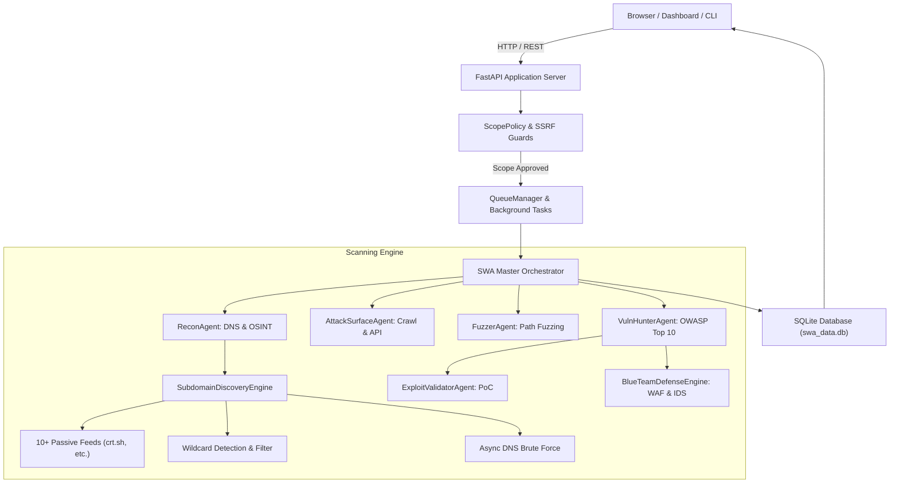

# ⚡ SWA AI — Autonomous Security Auditor

<p align="center">
  <b>Enterprise Autonomous Multi-Agent AI Security Auditor & Cyber Operations Platform</b><br>
  <i>Layered subdomain intelligence, continuous reconnaissance, OWASP Top 10 auditing, verifiable PoC exploits, and defensive WAF/SIEM posture hardening.</i>
</p>

<p align="center">
  
  
  
  
  
</p>

---

## 0. Responsible Use & Security Disclosure

> [!CAUTION]
> **Authorized Testing Only**: SWA AI is designed exclusively for authorized penetration testing, security assessments of systems you own or have explicit written permission to test, and educational research in local laboratory environments.
>
> Unauthorized scanning, probing, or exploiting of computer systems without prior mutual consent is strictly illegal and violates national and international cybersecurity laws.

## 📄 License

SWA AI is licensed under the [MIT License](https://github.com/545e/SWA/blob/main/LICENSE).

---

## 📑 Table of Contents

0. [Responsible Use & Security Disclosure](#0-responsible-use--security-disclosure)

1. [Project Overview & Purpose](#1-project-overview--purpose)
2. [Feature List & Implementation Status](#2-feature-list--implementation-status)
3. [User Interface & Dashboard Overview](#3-user-interface--dashboard-overview)
4. [Architecture & Request Flow](#4-architecture--request-flow)
5. [Technology Stack](#5-technology-stack)
6. [Directory Structure](#6-directory-structure)
7. [Prerequisites & Supported Operating Systems](#7-prerequisites--supported-operating-systems)
8. [Installation & Setup](#8-installation--setup)
9. [Environment Configuration (`.env.example`)](#9-environment-configuration-envexample)
10. [Database Architecture & Migrations](#10-database-architecture--migrations)
11. [How to Start the Platform](#11-how-to-start-the-platform)
12. [How to Use the Security Operations Dashboard](#12-how-to-use-the-security-operations-dashboard)
13. [Detailed Tool Explanations](#13-detailed-tool-explanations)
14. [CLI Commands, Syntax & Expected Output](#14-cli-commands-syntax--expected-output)
15. [Subdomain Enumeration Workflow & Wildcard Detection](#15-subdomain-enumeration-workflow--wildcard-detection)
16. [REST API Endpoints & Examples](#16-rest-api-endpoints--examples)
17. [Scan Profiles, Scope Policy & SSRF Guard](#17-scan-profiles-scope-policy--ssrf-guard)
18. [Automated Testing & QA Verification](#18-automated-testing--qa-verification)
19. [Known Limitations & External Dependencies](#19-known-limitations--external-dependencies)
20. [Responsible Use & Security Disclosure](#20-responsible-use--security-disclosure)

---

## 1. Project Overview & Purpose

**SWA AI (Autonomous Security Auditor)** is an enterprise application security auditing and offensive/defensive operations platform. It bridges autonomous AI-driven red teaming with actionable blue team defensive hardening:

- **Autonomous Multi-Agent Red Team Pipeline**: Executes structured reconnaissance, layered OSINT, active DNS resolution with wildcard filtering, path fuzzing, OWASP Top 10 scanning, verifiable cURL proof-of-concept (PoC) generation, and source code remediation patches.
- **Interactive Cyber Tools Hub**: Instant diagnostics for DNS records (SPF/DMARC), HTTP security headers, TLS inspection, port discovery, WHOIS/RDAP threat intelligence, cryptography/hashes, JWT debugging, and single-vector vulnerability probes.
- **Blue Team Defense Center**: Automatically translates verified findings into production defensive configurations (ModSecurity WAF, Cloudflare WAF, AWS WAF, Snort/Suricata IDS rules, and Sigma/SIEM queries).
- **DFIR Forensics Engine**: Ingests Apache, Nginx, Linux syslog, and Windows IIS access logs to detect active exploit footprints and generate 1-click firewall ban rules (`iptables`, `ufw`, `netsh`).

---

## 2. Feature List & Implementation Status

| Capability / Module | Implementation Status | Backend Engine |
| :--- | :---: | :--- |
| **Layered Subdomain Discovery** | ✅ Genuine / Functional | 10+ OSINT feeds, `dns.asyncresolver`, Wildcard Detection |
| **Wildcard DNS Detection & Filtering**| ✅ Genuine / Functional | Dynamic pseudo-random host probing & IP baseline subtraction |
| **DNS, SPF & DMARC Analyzer** | ✅ Genuine / Functional | Native `dnspython` + standard socket fallback |
| **HTTP Security Header Audit** | ✅ Genuine / Functional | 8 headers audited + letter grade (A+ to F) |
| **TLS/SSL Deep Inspector** | ✅ Genuine / Functional | Python `ssl` handshake, cipher extraction, SANs, days to expiry |
| **Asynchronous Port Scanner** | ✅ Genuine / Functional | Non-blocking async TCP socket pool |
| **Single-Vector Prober** | ✅ Genuine / Functional | SQLi, XSS, LFI, SSRF, CORS, Open Redirect prober |
| **Path & Parameter Fuzzer** | ✅ Genuine / Functional | Dual-baseline anomaly filter (eliminates SPA wildcards) |
| **OWASP Top 10 Exploits** | ✅ Genuine / Functional | Modular plugin architecture in `plugins/owasp_plugins.py` |
| **PoC Validation & CVSS** | ✅ Genuine / Functional | Non-destructive validation with exact cURL command generation |
| **Blue Team Defense Engine** | ✅ Genuine / Functional | ModSecurity, AWS WAF, Cloudflare WAF, Snort, Suricata, Sigma |
| **Digital Forensics (DFIR)** | ✅ Genuine / Functional | Regex multi-footprint log parser & threat actor correlation |
| **GhostJS Secret Scanner** | ✅ Genuine / Functional | 150+ signatures with Shannon entropy verification |
| **REA Reverse Engineering** | ✅ Genuine / Functional | Binary disassembly, header analysis, strings extraction |
| **SSRF & Scope Enforcement** | ✅ Genuine / Functional | Server-side IP parsing, IMDS blocking, DNS rebinding guard |
| **Report Generation** | ✅ Genuine / Functional | HTML, PDF, CSV, JSON, SARIF 2.1.0, Markdown exports |
| **Security Data Management** | ✅ Genuine / Functional | CSV/JSONL ingestion, PII & AWS/JWT secret leakage scanner |
| **Hardware-Aware AI Training** | ✅ Genuine / Functional | CUDA/MPS/CPU auto-detection, epoch loss decay, checkpoints |
| **Model Tuning & Evaluation** | ✅ Genuine / Functional | F1, Precision, Recall, 2x2 Confusion Matrix, token cost |
| **OWASP LLM Red-Teaming** | ✅ Genuine / Functional | 12-category adversarial test harness with synthetic canaries |
| **Unified Tool Catalog** | ✅ Genuine / Functional | Centralized metadata, schemas, and scopes for all 16 tools |

---

## 3. User Interface & Dashboard Overview

The SWA AI dashboard is designed as a Security Operations Center (SOC) with:

```text
+--------------------------------------------------------------------------------------------------+
|  ⚡ SWA AI Autonomous Security Auditor    [● Engine Ready]   [☀️/🌙 Theme]   [Ctrl+K Palette]    |
+--------------------------------------------------------------------------------------------------+
|  [📊 Dashboard] [🌐 Recon] [🎯 Pentest] [⚡ Path Fuzzer] [🛠️ Tools] [🛡️ WAF] [🔬 Forensics] ...    |
+--------------------------------------------------------------------------------------------------+
|  TARGET INPUT: [ https://example.com                                      ] [ ▶ START AUDIT ]    |
|  PROFILES:     (•) Passive Recon   ( ) Standard Assessment   ( ) Authorized Lab Assessment       |
|  ADVANCED:     [x] Subdomains  [x] Ports  [x] Headers  [x] SSL  [x] Fuzzing  [x] OWASP Checks   |
+--------------------------------------------------------------------------------------------------+
|  LIVE PROGRESS: Phase 1/5: Layered Reconnaissance (Tasks: 2/5)     [⏱️ 00:14] [ 35% ] [ STOP ]   |
+--------------------------------------------------------------------------------------------------+
|  POSTURE SCORE: 85/100 (Grade B)                                                                |
|  Formula: 100 - (30×Crit + 18×High + 8×Med + 4×Low + 1×Info)                                    |
|  [Critical: 0]   [High: 0]   [Medium: 1 (-8 pts)]   [Low: 1 (-4 pts)]   [Info: 3 (-3 pts)]       |
+--------------------------------------------------------------------------------------------------+
|  SUBDOMAIN INVENTORY:                                                                            |
|  [Discovered: 28]  [Resolved: 26]  [Live HTTP/S: 24]  [Wildcard: 0]  [Unresolved: 2] [📥 Export] |
+--------------------------------------------------------------------------------------------------+
|  FINDINGS TABLE: Title | Severity | Affected Asset | Verification | Confidence | Actions         |
+--------------------------------------------------------------------------------------------------+
|  TERMINAL LOG STREAM: Real-time sanitized execution messages & live discovery feeds              |
+--------------------------------------------------------------------------------------------------+
```

### Key UI Capabilities
- **Color Discipline**: Navy backgrounds (`#0b0f17`, `#131b26`), crisp borders (`#233044`). Red is strictly reserved for critical vulnerabilities and dangerous states; green indicates verified hardening; amber denotes warnings; blue/cyan denotes informative context.
- **Working Light / Dark Mode**: Toggles seamlessly between dark navy and crisp light themes with persistent `localStorage` memory.
- **Responsive Layout**: Adapts gracefully across desktop monitors, tablets, and mobile viewports.
- **Subdomain Inventory Hub**: Displays accurate metrics for Discovered, Resolved, Live HTTP, Wildcard Suspected, and Unresolved assets with real-time filtering and CSV export.

---

## 4. Architecture & Request Flow



### Complete Request Flow
1. **Target Submission**: User submits target via Dashboard or CLI.
2. **Scope Validation**: Target is parsed; scheme, hostname, and IP are strictly validated against SSRF rules (cloud metadata, loopback, RFC1918).
3. **Task Queuing**: Scan job is saved as `PENDING` in SQLite and dispatched as a background async task.
4. **Reconnaissance & Subdomains**: Layered discovery runs: passive OSINT feeds, wildcard baseline detection, and active DNS resolution. Live HTTP status and titles are fingerprinted.
5. **Attack Surface Discovery & Fuzzing**: Responsive assets are crawled, API routes mapped, and path anomalies probed.
6. **OWASP Top 10 Hunting**: Active modular plugins validate vulnerabilities, verify PoCs, and compute exact CVSS scores.
7. **Defensive Rule Generation**: WAF, IDS, and SIEM rules are compiled.
8. **Real-Time Streaming**: Logs and findings stream to the client via WebSockets/SSE; final reports are generated in HTML, JSON, SARIF 2.1.0, CSV, and Markdown.

---

## 5. Technology Stack

- **Backend**: Python 3.10 / 3.11 / 3.12, FastAPI, Uvicorn, Pydantic v2
- **Networking & DNS**: `httpx` (async HTTP client), `dnspython` (async DNS resolver), `urllib3`
- **Database**: Thread-safe SQLite 3 with automatic schema migration
- **Frontend**: Pure modern JavaScript (ES6+), HTML5, CSS3 with CSS Variables (zero heavyweight frontend runtime dependencies)
- **Reporting**: Jinja2 templating, SARIF 2.1.0 standard schema, RFC 4180 CSV
- **Testing**: `unittest`, `pytest`, `unittest.mock`

---

## 6. Directory Structure

```text
swa-ai/
├── agents/                     # Autonomous AI scanning agents
│   ├── amass_engine.py         # Layered subdomain discovery & wildcard engine
│   ├── attack_surface_agent.py # Web crawler & route extractor
│   ├── fuzzer_agent.py         # Anomaly-filtered path fuzzer
│   ├── orchestrator.py         # Master workflow controller
│   ├── recon_agent.py          # Reconnaissance coordinator
│   └── vuln_hunter_agent.py    # OWASP Top 10 scanner
├── config/                     # Target scope and environment configurations
│   └── targets.json            # Scope allowlist configuration
├── core/                       # Core system modules & utilities
│   ├── ai_evaluation.py        # Model tuning, benchmarks & confusion matrix
│   ├── ai_training.py          # Hardware-aware training & checkpointing
│   ├── blue_team_engine.py     # WAF, IDS, and SIEM rule generator
│   ├── cyber_tools.py          # Instant cyber utility toolkit
│   ├── data_management.py      # Security dataset ingestion & leak scanner
│   ├── database.py             # SQLite thread-safe persistence layer
│   ├── forensics_engine.py     # DFIR access log analysis engine
│   ├── js_intelligence.py      # GhostJS 150+ secret scanner
│   ├── llm_security_testing.py # 12-category OWASP LLM red-team harness
│   ├── models.py               # Pydantic schemas and data models
│   ├── queue_manager.py        # Async task queue & WebSocket event bus
│   ├── rea_engine.py           # REA reverse engineering engine
│   ├── scanner_integrations.py # Subprocess wrappers for external tools
│   ├── scope_policy.py         # SSRF protection and target validator
│   └── tool_registry.py        # Centralized schema catalog for all 16 tools
├── docs/                       # Comprehensive documentation
│   ├── AI_TRAINING.md          # Model training, fine-tuning & evaluation guide
│   ├── API_REFERENCE.md        # Comprehensive REST API reference manual
│   ├── ARCHITECTURE.md         # System architecture and data flow
│   ├── COMMAND_REFERENCE.md    # Verified tool command reference
│   ├── DEPLOYMENT.md           # Deployment, production WSGI & Docker guide
│   ├── LLM_SECURITY_TESTING.md # 12-category OWASP LLM red-team guide
│   ├── SUBDOMAIN_ENUMERATION.md# Subdomain engine & wildcard detection guide
│   ├── TROUBLESHOOTING.md      # Diagnostics and issue resolution guide
│   └── TOOLS.md                # Integrated tool catalog
├── plugins/                    # Modular OWASP vulnerability plugins
│   ├── base_plugin.py          # Plugin interface
│   └── owasp_plugins.py        # SQLi, XSS, SSRF, LFI, CORS, etc.
├── reports/                    # Assessment report generators
│   └── generator.py            # HTML, JSON, SARIF, CSV, Markdown exporter
├── tests/                      # Automated test suite (65 Tests)
│   ├── test_ai_training_and_evaluation.py # Hardware, training, F1 & eval tests
│   ├── test_api_and_dashboard.py # REST endpoints, settings, report export tests
│   ├── test_data_management.py # Dataset parsing, leak detection & split tests
│   ├── test_e2e_local_scan.py  # End-to-end authorized scan tests
│   ├── test_llm_security_testing.py # 12-category LLM attack & canary tests
│   ├── test_owasp_plugins.py   # OWASP Top 10 detection tests
│   ├── test_rea_engine.py      # Reverse engineering tests
│   ├── test_scanner_integrations.py # External binary wrapper checks
│   ├── test_scope_policy.py    # SSRF protection & scope validation tests
│   ├── test_subdomain_engine.py# 10 required subdomain scenarios
│   └── test_tool_registry.py   # Tool catalog, schemas & asset inventory tests
├── web/                        # Web dashboard assets
│   ├── server.py               # FastAPI server routes & WebSocket endpoints
│   └── static/
│       ├── app.js              # Dashboard client controller
│       ├── index.html          # Responsive SOC dashboard UI
│       └── styles.css          # Navy theme engine & responsive styles
├── .env.example                # Safe environment variable template
├── requirements.txt            # Python dependencies
├── run.py                      # One-click startup runner
└── swa_cli.py                  # Unified CLI and background service entrypoint
```

---

## 7. Prerequisites & Supported Operating Systems

- **Supported Platforms**: Windows 10/11, Windows Server 2019+, Ubuntu 20.04/22.04/24.04, Debian 11/12, macOS 12+ (Monterey/Ventura/Sonoma).
- **Python Version**: Python 3.10, 3.11, or 3.12 (Python 3.12 recommended).
- **System Memory**: Minimum 1 GB RAM (2 GB recommended for concurrent deep scans).
- **Disk Space**: 150 MB for core installation and database.

---

## 8. Installation & Setup

### Step 1: Clone or Navigate to the Repository
```bash
git clone https://github.com/your-org/swa-ai.git
cd swa-ai
```

### Step 2: Create and Activate Virtual Environment
**On Windows**:
```powershell
python -m venv venv
.\venv\Scripts\activate
```

**On Linux / macOS**:
```bash
python3 -m venv venv
source venv/bin/activate
```

### Step 3: Install Required Dependencies
```bash
pip install -r requirements.txt
```

### Step 4: Configure Environment File
```bash
cp .env.example .env
```

---

## 9. Environment Configuration (`.env.example`)

A safe `.env.example` template is provided with no real credentials:

```bash
# Server Configuration
SWA_HOST=127.0.0.1
SWA_PORT=8000
SWA_LOG_LEVEL=info

# Scope & Lab Mode Configuration
SWA_LAB_MODE=false
SWA_ALLOWED_TARGETS_FILE=config/targets.json

# Scan Execution Limits
SWA_DEFAULT_CONCURRENCY=5
SWA_DEFAULT_MAX_DEPTH=2
SWA_SCAN_TIMEOUT_SEC=60

# Optional AI Provider Configuration
SWA_AI_PROVIDER=auto
SWA_AI_MODEL=minimax/minimax-m3.1-flash:free
SWA_AI_API_KEY=your_api_key_here
SWA_AI_BASE_URL=https://openrouter.ai/api/v1
```

---

## 10. Database Architecture & Migrations

- SWA AI uses an embedded SQLite database (`swa_data.db`) managed via `core/database.py`.
- Thread-safe connections are maintained via Python's standard `sqlite3` module with row factory support.
- **Automatic Schema Migration**: Upon initialization, the database verifies existing tables (`scans`, `findings`, `logs`, `settings`) and automatically executes `ALTER TABLE` migrations for any missing columns without data loss.

---

## 11. How to Start the Platform

### Option A: Launch Interactive Web Operations Dashboard
```bash
python run.py
```
*Or via CLI wrapper:*
```bash
python swa_cli.py --web --host 127.0.0.1 --port 8000
```
Open **`http://127.0.0.1:8000`** in your browser.

### Option B: Run Standalone CLI Assessment
```bash
# Passive Reconnaissance (Zero active traffic)
python swa_cli.py -t example.com -p passive_recon

# Standard Assessment
python swa_cli.py -t example.com -p standard

# Authorized Lab Assessment (e.g., local testbed)
python swa_cli.py -t "http://127.0.0.1:8000" -p lab_assessment --lab-mode
```

---

## 12. How to Use the Security Operations Dashboard

1. **Enter Target**: Input target domain (e.g. `example.com`), URL (`https://app.example.com`), or authorized IP (`127.0.0.1:8000`).
2. **Choose Profile**: Select **Passive Recon**, **Standard Assessment**, or **Authorized Lab Assessment**.
3. **Configure Engines**: Expand **Advanced Scope & Concurrency Controls** to adjust crawl depth, concurrency, or toggle individual security tools.
4. **Launch Scan**: Click **Start Audit** (or press Enter).
5. **Monitor Live Execution**: Observe the real-time progress bar, stage indicator, elapsed timer, and live terminal stream. Click **Stop Audit** at any point to safely cancel execution.
6. **Analyze Posture**: Review the calculated Security Posture Score, letter grade, and breakdown of findings.
7. **Inspect Subdomains**: Switch to the **Subdomains** tab to view mapped assets, IP addresses, HTTP status, and validation status (Confirmed, Wildcard Suspected, Unresolved). Export findings via **Export CSV**.
8. **Export Reports**: Download reports in HTML, JSON, SARIF 2.1.0, CSV, or Markdown.

---

## 13. Detailed Tool Explanations

1. **Subdomain Engine (`agents/amass_engine.py`)**: Multi-source passive CT/DNS ingestion coupled with active async DNS queries. Performs automated wildcard baseline detection and CNAME subdomain takeover verification across 17+ cloud providers.
2. **DNS & Email Security (`core/cyber_tools.py`)**: Resolves DNS records and inspects SPF and DMARC enforcement to detect email spoofing exposure.
3. **Security Headers Evaluator (`core/cyber_tools.py`)**: Audits defensive response headers and server banner disclosure, awarding a grade from A+ to F.
4. **SSL/TLS Deep Inspector (`core/cyber_tools.py`)**: Performs TLS handshakes, verifies validity dates, computes days remaining until expiration, and validates protocol versions.
5. **Path & Parameter Fuzzer (`agents/fuzzer_agent.py`)**: Evaluates anomalous status codes, response lengths, and titles while filtering out SPA false-positive reflections.
6. **OWASP Top 10 Hunting (`plugins/owasp_plugins.py`)**: Validates SQL Injection, Reflected Cross-Site Scripting (XSS), Server-Side Request Forgery (SSRF), Local File Inclusion (LFI), and CORS misconfigurations.
7. **GhostJS Secret Scanner (`core/js_intelligence.py`)**: Scans client-side scripts with 150+ signatures and Shannon entropy false-positive suppression.
8. **DFIR Forensics (`core/forensics_engine.py`)**: Detects attack footprints in server access logs and generates 1-click firewall ban syntax.

---

## 14. CLI Commands, Syntax & Expected Output

Refer to **[docs/COMMAND_REFERENCE.md](docs/COMMAND_REFERENCE.md)** for the complete guide. Key examples:

```bash
# Subdomain Discovery
python swa_cli.py --subdomains example.com --export-subs subs.json

# HTTP Security Header Audit
python swa_cli.py --headers https://example.com

# SSL Certificate Inspection
python swa_cli.py --ssl example.com

# Asynchronous Port Probing
python swa_cli.py --ports 127.0.0.1 --port-list 80,443,8000,8080

# Targeted Single-Vector Vulnerability Probe
python swa_cli.py --probe "http://127.0.0.1:8000/api/search?q=test" --probe-vuln xss

# DFIR Forensics Analysis on Access Log
python swa_cli.py --forensics-sample apache_nginx
```

---

## 15. Subdomain Enumeration Workflow & Wildcard Detection

The SWA AI Subdomain Engine operates in five distinct phases:

1. **Wildcard DNS Baseline Probing**: Resolves 3 pseudo-random nonexistent hostnames (e.g. `swa-wc-a1b2c3d4.example.com`). If multiple random queries resolve to identical IPs, wildcard DNS is verified and the IP footprint is recorded as a baseline.
2. **Passive Intelligence Harvesting**: Concurrently queries 10+ passive feeds (crt.sh, HackerTarget, AlienVault OTX, CertSpotter, Wayback CDX, ThreatMiner, URLScan, Subdomain Center, Anubis, RapidDNS). Each feed runs under an isolated try/except block with independent timeouts.
3. **Active DNS Resolution**: Probes a curated 350+ enterprise dictionary using `dns.asyncresolver.Resolver` with fallback public nameservers (1.1.1.1, 8.8.8.8). Any candidate resolving exclusively to the wildcard baseline is flagged as `wildcard_suspected`.
4. **AltDNS Permutations**: Generates contextual mutations (`dev-api`, `stage-api`) for confirmed hosts.
5. **Live Verification & Takeover Auditing**: Discovered assets are probed over HTTPS/HTTP to extract status codes, Server banners, and HTML titles. CNAME chains are evaluated against 17+ cloud providers to detect unclaimed assets.

---

## 16. REST API Endpoints & Examples

| Method | Endpoint | Description |
| :--- | :--- | :--- |
| `POST` | `/api/scans` | Submit and launch a new assessment scan |
| `GET` | `/api/scans` | List all historical and active scans |
| `GET` | `/api/scans/{id}` | Retrieve details and status of a specific scan |
| `POST` | `/api/scans/{id}/cancel` | Abort a running background scan |
| `GET` | `/api/scans/{id}/findings` | Retrieve verified vulnerability findings |
| `GET` | `/api/scans/{id}/report` | Export report (`?format=html\|json\|sarif\|csv\|markdown`) |
| `POST` | `/api/tools/subdomains` | Standalone on-demand subdomain enumeration |
| `POST` | `/api/tools/dns` | DNS records and SPF/DMARC spoofing audit |
| `POST` | `/api/tools/headers` | HTTP security header audit & grading |
| `POST` | `/api/tools/ssl` | SSL/TLS certificate inspection |
| `POST` | `/api/tools/ports` | TCP port probing & service detection |
| `POST` | `/api/tools/probe` | Instant single-vector vulnerability probe |
| `GET` | `/api/tools/status` | Host cybersecurity tool availability status |

---

## 17. Scan Profiles, Scope Policy & SSRF Guard

### Scan Profiles
- **Passive Recon (`passive_recon`)**: Completely passive; queries OSINT, CT logs, DNS, and HTTP headers without active probing.
- **Standard Assessment (`standard`)**: Comprehensive balanced audit; runs subdomain mapping, port probing, and OWASP Top 10 checks.
- **Authorized Lab Assessment (`lab_assessment`)**: Explicitly authorizes local test targets (`127.0.0.1`, `localhost`, PortSwigger labs) with safe exploit validation.
- **Full Red Team (`full_red_team`)**: Deep assessment with parameter fuzzing, active PoC exploit validation, and patch generation.

### Scope & SSRF Guards (`core/scope_policy.py`)
- **Scheme Validation**: Strictly restricts protocols to `http://` and `https://` (blocks `file://`, `gopher://`, `dict://`).
- **Restricted IP Blocking**: Automatically detects and blocks access to cloud metadata services (IMDS `169.254.169.254`, `fd00:ec2::254`), private networks (RFC 1918), and IPv4-mapped IPv6 loopbacks (`::ffff:127.0.0.1`) unless explicitly authorized in Lab Mode.
- **DNS Rebinding Protection**: Pre-resolves domain hostnames server-side to ensure target IP remains in-scope during active probing.

---

## 18. Automated Testing & QA Verification

Run the comprehensive automated test suite:

```bash
# Run all tests using unittest
python -m unittest discover tests

# Or run via pytest
pytest -v
```

### Test Suite Breakdown (41 Total Tests)
- `tests/test_subdomain_engine.py` (10 tests):
  1. Known test subdomains mapping
  2. Wildcard DNS detection & baseline filtering
  3. Multi-source deduplication & attribution
  4. Malformed and invalid hostname rejection
  5. Failing or timed-out passive provider resilience
  6. DNS resolver failure handling
  7. Empty result handling
  8. Missing API credentials graceful degradation
  9. HTTP 429 rate-limiting responses
  10. Early cancellation preservation
- `tests/test_scope_policy.py` (9 tests): Target normalization, scheme restrictions, IMDS blocking, RFC 1918 blocking, and lab mode validation.
- `tests/test_owasp_plugins.py` (3 tests): SQLi, XSS, and SSRF detection.
- `tests/test_rea_engine.py` (14 tests): Disassembly, header parsing, string extraction, and fallback modes.
- `tests/test_scanner_integrations.py` (3 tests): External tool discovery and health checks.
- `tests/test_e2e_local_scan.py` (2 tests): End-to-end authorized scan execution and multi-format report export.

---

## 19. Known Limitations & External Dependencies

- **Passive CT Logs (crt.sh)**: Free public CT logs can experience intermittent rate limits or connection timeouts during high global traffic. SWA AI incorporates regex HTML fallbacks and 9 alternative feeds to mitigate provider outages.
- **Raw IP Targets**: Subdomain enumeration is intentionally bypassed for raw IP addresses (e.g. `127.0.0.1`).
- **External Binaries**: External tools (Nmap, Nuclei, ZAP, SQLmap) are optional. If absent on the host, SWA AI seamlessly uses its high-speed native Python async auditing engines.

---

## 19. AI Model Security, Training, Tuning & Red-Teaming

SWA AI provides a dedicated, native AI Security suite for developing, evaluating, and auditing machine learning and LLM systems:

### A. Security Data Management (`/api/datasets`)
- **Corpus Ingestion**: Supports `.csv`, `.jsonl`, `.json`, and `.txt` files with strict MIME type and UTF-8 encoding validation.
- **Automated Secret Scanning**: Pre-scans datasets for AWS keys, private certificates, JWT tokens, and connection strings.
- **Reproducible Partitioning**: Configurable stratified Train / Validation / Test splits (e.g. 70/15/15) with random seeds.
- **Secret Redaction**: Automated sanitization replacing discovered credentials with placeholder tokens.

### B. Hardware-Aware AI Training (`/api/ai/training`)
- **Compute Detection**: Automatically detects CUDA GPUs, Apple Silicon MPS Neural Engines, or multicore CPUs.
- **Model Training**: Asynchronous background training of vulnerability classifiers and payload anomaly detectors.
- **Epoch Loss History & Artifacts**: Tracks loss decay, validation accuracy, and saves checkpoint files to `data/model_checkpoints/`.

### C. Model Tuning & Benchmark Evaluation (`/api/ai/evaluation`)
- **Classification Metrics**: Computes Precision, Recall, F1 score, Accuracy, and a full 2x2 Confusion Matrix (`TP`, `FP`, `TN`, `FN`) on held-out test splits.
- **Inference Telemetry**: Evaluates average latency (ms), token throughput (tok/s), token usage (prompt + completion), and estimated provider cost ($/1M tokens).

### D. LLM Adversarial Red-Team Test Harness (`/api/ai/redteam`)
- Audits models across all 12 OWASP Top 10 for LLM threat categories:
  1. *Direct Prompt Injection* (delimiter escaping, system overrides)
  2. *Indirect Prompt Injection* (third-party document payload injection)
  3. *System Prompt Extraction* (instruction & secret exfiltration)
  4. *Jailbreak Robustness* (DAN/roleplay persona framing)
  5. *Sensitive Data Disclosure* (synthetic canary token extraction)
  6. *Insecure Output Handling* (HTML/XSS script generation)
  7. *Excessive Agency* (unauthorized command execution)
  8. *RAG Poisoning* (adversarial corpus injection)
  9. *Training Data Leakage* (memorized credential probing)
  10. *Unsafe Tool Permissions* (privilege parameter escalation)
  11. *Denial of Service* (recursive expansion & token flooding)
  12. *Auth Failures in AI Integrations* (tenant isolation breaches)
- Utilizes synthetic canary tokens (`SECRET_CANARY_TOKEN_918273_SWA`) and generates evidence-based audit reports with pass/fail grades and actionable mitigations.

---

## 20. Unified Tool Catalog & Registry

All 16 offensive, defensive, OSINT, forensics, and AI evaluation tools in SWA AI are indexed in a centralized registry accessible via `GET /api/tools/registry` and the interactive **Tool Catalog** dashboard tab:
- **Category A: SOC Platform** (Risk Scorer, Scan Posture Diff Engine, Multi-Format Report Generator)
- **Category B: Reconnaissance** (Amass & Subfinder Subdomain Engine, Port & Service Prober, Tech Stack Fingerprinter)
- **Category C: Web Application Security** (OWASP Hunting Suite, Path & Parameter Fuzzer, REA Reverse Engineering Engine, GhostJS Secret Scanner)
- **Category D: Blue-Team & Forensics** (WAF Rule Synthesizer, SIEM Detection Rule Generator, Security Log Correlator)
- **Category E: AI & LLM Security** (Security Dataset Manager, AI Model Trainer, Model Tuning Evaluator, LLM Red-Team Harness)

---

## 21. Responsible Use & Security Disclosure

> [!CAUTION]
> **Authorized Testing Only**: SWA AI is designed exclusively for authorized penetration testing, security assessments of systems you own or have explicit written permission to test, and educational research in local laboratory environments.
>
> Unauthorized scanning, probing, or exploiting of computer systems without prior mutual consent is strictly illegal and violates national and international cybersecurity laws.

---

## 📄 License

SWA AI is licensed under the [MIT License](https://github.com/545e/SWA/blob/main/LICENSE).
