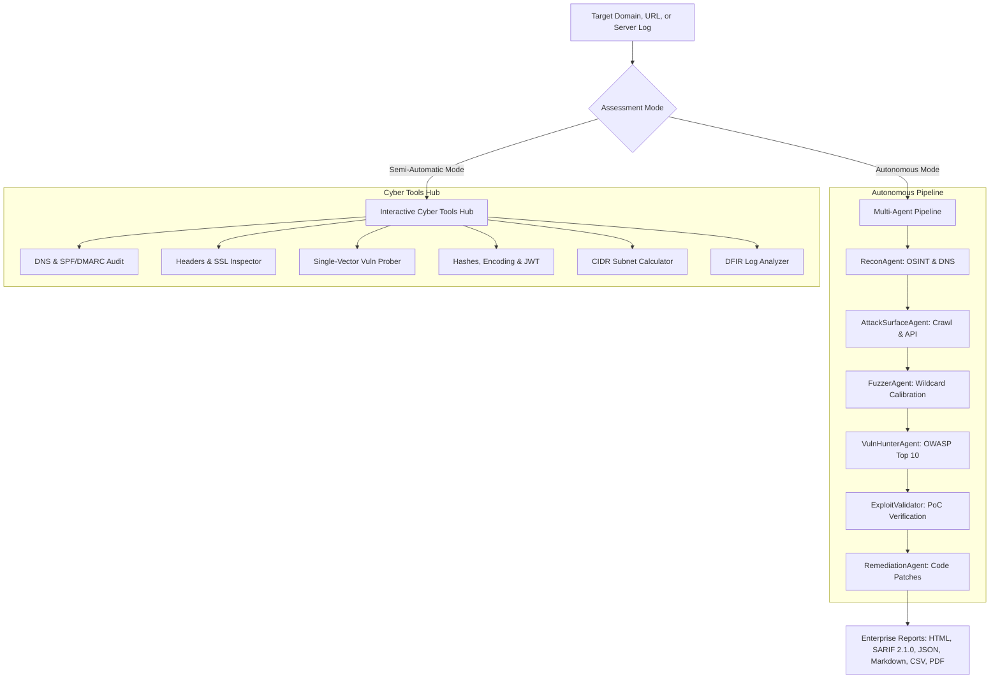

# ⚡ SWA AI — Autonomous & Semi-Automatic Cybersecurity Platform

<p align="center">
  <b>Enterprise-Grade Autonomous Multi-Agent AI Red Team & Semi-Automatic Cybersecurity Swiss Army Knife.</b><br>
  <i>Discover, validate, and remediate application vulnerabilities with zero false positives. Analyze attack footprints, harden WAF/SIEM rules, and run instant on-demand cyber diagnostics.</i>
</p>

<p align="center">
  
  
  
  
  
</p>

---

## 🌟 Overview

**SWA AI** (Secure Web Auditor AI) is a next-generation offensive and defensive cyber engineering platform. Designed for penetration testers, security analysts, DevSecOps teams, and SOC engineers, SWA operates in two synchronized operational modes:

1. **Autonomous Multi-Agent Red Team Pipeline**: An autonomous AI agent engine that conducts end-to-end OSINT, active DNS enumeration, brute-force & alter-DNS permutation, directory fuzzing, OWASP Top 10 auditing, dynamic PoC exploit verification (cURL), and developer-ready code patches.
2. **Interactive Semi-Automatic Cyber Tools Hub**: An instant-response cyber toolkit providing immediate single-vector vulnerability testing, DNS/SPF/DMARC spoofing audits, HTTP security header grading (A+ to F), SSL/TLS certificate inspection, cryptographic digests, JWT debugging, CIDR subnetting, and authorized penetration testing payload references.

---

## 🚀 Key Capabilities & Modules

### 1. 🛠️ Semi-Automatic Cyber Tools Hub
- **👻 GhostJS JavaScript Intelligence & 150+ Secret Scanner**:
  - High-speed passive and active scanner for client-side JavaScript bundles, HTML, and JSON responses.
  - **150+ Detection Signatures** covering AWS, GCP, Azure, GitHub, OpenAI, Stripe, Twilio, SendGrid, MongoDB, Postgres, SSH/RSA private keys, and SaaS tokens across 23 categories.
  - **Shannon Entropy Analysis**: Multi-stage false-positive suppression that eliminates documented sample keys, dummy placeholders, kebab slugs, public-by-design keys, and low-entropy junk.
  - **Attack Surface Discovery**: Automatically extracts internal REST/GraphQL/OpenAPI routes, cloud object-storage buckets (AWS S3, Google GCS, Azure Blob, Cloudflare R2), and exposed source maps (`.map`).
- **🌐 DNS & Email Security Analyzer**: Queries A, AAAA, MX, TXT, NS, CNAME, SOA records and automatically audits SPF (`v=spf1`) and DMARC (`v=DMARC1`) policies for domain spoofing vulnerabilities.
- **🛡️ HTTP Security Headers Evaluator**: Audits 8 critical security headers (HSTS, CSP, X-Frame-Options, X-Content-Type-Options, Referrer-Policy, Permissions-Policy, COOP, CORP), detects tech stack server banner leaks, and calculates an actionable Letter Grade from **A+ down to F**.
- **🔒 SSL/TLS Certificate Deep Inspector**: Conducts TLS handshakes, verifies validity dates, computes days remaining until expiration with automated alerts, inspects Subject Alternative Names (SANs), active TLS protocol versions, and cipher suites.
- **⚡ Targeted Single-Vector Vulnerability Prober**: Conducts focused, instant security probes on a specific target URL and parameter (SQLi, Reflected XSS, Path Traversal/LFI, SSRF, CORS) and delivers immediate execution evidence and copy-paste reproduction cURL commands.
- **🔐 Cryptography, Encoding & JWT Debugger**:
  - Calculates instant digests: MD5, SHA-1, SHA-256, SHA-512, and NTLM.
  - Multi-format encoders/decoders: Base64, URL encoding, Hexadecimal, and HTML entities.
  - Full JWT token analyzer: Decodes Header and Payload, analyzes signing algorithms, identifies insecure `none` algorithm bypasses, and checks expiration timestamps.
- **🧮 CIDR & Subnet Calculator**: Calculates network address, broadcast address, netmask, wildcard mask, usable IP host ranges, and total host counts for IPv4 and IPv6 blocks.
- **💻 Authorized Pentesting Shell & Payload Reference**: Quick-reference command generator for Bash, PowerShell, Python 3, Netcat, and Socat.

### 2. 🤖 Autonomous Multi-Agent Red Team Engine
- **🔍 ReconAgent**: Automated OSINT, passive Certificate Transparency log queries (crt.sh), HackerTarget, AlienVault OTX, active DNS dictionary resolution, high-speed asynchronous port scanner, and tech stack fingerprinting.
- **🗺️ AttackSurfaceAgent**: Asynchronous web crawler, HTML form/parameter extractor, and REST/GraphQL/OpenAPI route discovery.
- **⚡ FuzzerAgent**: Dual-baseline anomaly-filtered path, directory, and hidden parameter fuzzer calibrated to eliminate Single Page Application (SPA) wildcard false positives.
- **🏹 VulnHunterAgent**: Modular OWASP Top 10 vulnerability scanner (SQLi, XSS, SSRF, LFI/Path Traversal, Insecure CORS, and Sensitive File Exposure).
- **💥 ExploitValidatorAgent**: Active verification of candidate vulnerabilities, generating verifiable reproduction cURL PoCs and calculating precise CVSS v3.1 scores.
- **🛡️ RemediationAgent**: Produces tailored defensive code patches (Python, JS/TS, PHP, Go) and web server hardening rules (Nginx, Apache).

### 3. 🛡️ Blue Team Defense Center & DFIR Forensics
- **WAF Rule Generation**: Generates production-ready rules for ModSecurity (OWASP CRS), Cloudflare WAF, AWS WAF v2, and Nginx.
- **Network IDS/IPS Signatures**: Automatically outputs Snort 3 and Suricata IDS rules.
- **SIEM & Log Analytics**: Generates Sigma rules (YAML), Splunk SPL, Elastic KQL, and Microsoft Sentinel queries.
- **Cross-Platform Digital Forensics (DFIR)**: Ingests Apache, Nginx, Windows IIS (W3C), and Linux syslog server access logs, correlates attack footprints, identifies threat actors, and outputs 1-click firewall ban commands (`iptables`, `ufw`, `netsh advfirewall`, and `pfctl`).

---

## 🛠️ Architecture



---

## 📦 Installation & Quick Start

### Prerequisites
- Python 3.10, 3.11, or 3.12
- Git

### Option 1: Automatic Installer (Recommended)

#### On Windows:
```cmd
git clone https://github.com/545e/SWA.git
cd SWA
install.bat
run.bat
```

#### On Linux / macOS:
```bash
git clone https://github.com/545e/SWA.git
cd SWA
chmod +x install.sh run.sh
./install.sh
./run.sh
```

### Option 2: Manual Python Installation

```bash
# 1. Clone repository
git clone https://github.com/545e/SWA.git
cd SWA

# 2. Create virtual environment
python3 -m venv venv
source venv/bin/activate  # On Windows: venv\Scripts\activate

# 3. Install dependencies
pip install -r requirements.txt

# 4. Optional: Install as system CLI package
pip install -e .

# 5. Launch the Web Interface
python run.py
```
Open **[http://127.0.0.1:8000](http://127.0.0.1:8000)** in your browser.

### Option 3: Docker Deployment

```bash
# Build and run with Docker
docker build -t swa-ai .
docker run -d -p 8000:8000 --name swa-cyber swa-ai

# Or with Docker Compose
docker compose up -d
```

---

## ❓ Troubleshooting & FAQs

### 1. "127.0.0.1 refused to connect / ERR_CONNECTION_REFUSED"
- **Cause:** The SWA web server is not running in the background.
- **Fix:** Double-click or run `run.bat` (or `python run.py`). Keep the terminal window **OPEN** while using the dashboard. SWA runs locally on `http://127.0.0.1:8000`.
- **Note:** `install.bat` now automatically starts `run.bat` as soon as package installation finishes.

### 2. "Does SWA need any other tools or API keys installed?"
- **No external binaries required:** SWA is 100% self-contained. All OSINT recon, GhostJS secrets scanning, DNS analysis, TLS handshake verification, port scanning, and OWASP Top 10 vulnerability checks run through pure Python asynchronous engines (`httpx`, `dnspython`, `cryptography`, `fastapi`).
- **Optional AI Remediations:** If you want LLM-powered remediation explanations and exploit synthesis, you can configure an OpenAI/Anthropic/Gemini API key in the UI settings or `.env`, but SWA performs all 100% of audits, scans, and reports autonomously without any API keys.

---

## 💻 CLI Reference & Cyber Expert Commands

SWA features a unified, highly versatile CLI for terminal workflows, automated scripting, and CI/CD pipelines:

### 1. Semi-Automatic Cyber Utility Commands

```bash
# JavaScript Intelligence: Scan website and all referenced JS bundles for secrets & API routes
python swa_cli.py --js-scan https://example.com --export-js js_findings.json

# Scan local JavaScript, JSON, or HTML file
python swa_cli.py --js-file ./app.js

# DNS Records & SPF/DMARC Email Spoofing Defense
python swa_cli.py --dns example.com

# HTTP Security Headers & Letter Grade (A+ to F)
python swa_cli.py --headers https://example.com

# SSL/TLS Deep Inspection & Expiry Tracker
python swa_cli.py --ssl example.com --ssl-port 443

# Fast Asynchronous TCP Port Scan
python swa_cli.py --ports example.com --port-list 80,443,8080,8443,3000,22

# WHOIS & IP / ASN Threat Intelligence
python swa_cli.py --whois 1.1.1.1

# Cryptographic Hashes (MD5, SHA1, SHA256, SHA512, NTLM)
python swa_cli.py --hash "MySecurePassword123"

# JSON Web Token (JWT) Inspector & Expiry Checker
python swa_cli.py --jwt "eyJhbGciOiJIUzI1NiIsInR5cCI6IkpXVCJ9..."

# Subnet & CIDR IP Range Calculator
python swa_cli.py --cidr 192.168.1.0/24

# Instant Targeted Single-Vector Vulnerability Probe
python swa_cli.py --probe "https://example.com/search?q=test" --probe-vuln sqli --probe-param q

# Authorized Pentest Reverse Shell Syntax Reference
python swa_cli.py --revshell --shell-ip 10.10.14.5 --shell-port 4444 --shell-type bash
```

### 2. Autonomous Red Team Assessments

```bash
# Full Red Team autonomous assessment with all agents
python swa_cli.py -t https://target.com --profile full_red_team

# Quick assessment with executive HTML and SARIF exports
python swa_cli.py -t https://target.com --profile quick --export-html report.html --export-sarif findings.sarif

# Autonomous multi-source OSINT subdomain discovery & takeover detection
python swa_cli.py --subdomains target.com --recursive --export-subs subdomains.txt

# Standalone OWASP Amass discovery
python swa_cli.py --amass target.com

# CI/CD Pipeline integration (always exit 0 to prevent pipeline breaks)
python swa_cli.py -t https://staging.internal --profile owasp_top10 --exit-zero
```

### 3. 🔄 Autonomous Continuous Surveillance Daemon

Run SWA AI in continuous surveillance mode to monitor company domains 24/7, detect newly spawned subdomains, track attack surface deltas, and automatically flag takeover vulnerabilities:

```bash
# Start background autonomous daemon (default: config/targets.json every 12 hours)
python swa_cli.py --daemon

# Specify custom target list and 6-hour scan cycle
python swa_cli.py --daemon --targets config/targets.json --interval-hours 6.0
```

Target configuration (`config/targets.json`):
```json
[
  {
    "domain": "example.com",
    "profile": "quick",
    "enabled": true
  }
]
```

### 4. DFIR Server Log Forensics & Threat Hunting

```bash
# Analyze Apache / Nginx / Linux syslog server access logs
python swa_cli.py --forensics-log /var/log/nginx/access.log

# Run built-in forensic test scenarios
python swa_cli.py --forensics-sample apache_nginx
python swa_cli.py --forensics-sample windows_iis
python swa_cli.py --forensics-sample wordpress_brute
```

---

---

## ⚡ GitHub Actions Autonomous Cloud Workflows

SWA AI comes with pre-configured, production-grade GitHub Actions workflows ready in `.github/workflows/`:

| Workflow | Trigger | Description |
| :--- | :--- | :--- |
| **Autonomous Security Audit** | `schedule` (Daily 03:00 UTC) & `workflow_dispatch` (Manual) | Performs automated penetration testing & subdomain discovery against designated targets. Generates HTML & SARIF 2.1.0 reports uploaded to GitHub Code Scanning! |
| **CI Matrix Testing** | `push` & `pull_request` | Automated validation across Python 3.10, 3.11, and 3.12, verifying all cyber expert CLI tools. |
| **GitHub CodeQL SAST** | `push` & `schedule` (Weekly) | Semantic static code analysis identifying potential vulnerabilities directly in GitHub Security tab. |
| **Docker Build & Verify** | `push` & `pull_request` | Builds Docker image and tests container health endpoint. |

### Running Autonomous Cloud Audits in GitHub:
1. Navigate to your repository's **Actions** tab on GitHub (`https://github.com/545e/SWA/actions`).
2. Select **SWA AI Autonomous Security Audit** on the left menu.
3. Click **Run workflow**, enter your authorized target domain (e.g. `https://example.com`), select the profile (`quick`, `owasp_top10`, `full_red_team`), and click **Run workflow**.
4. The workflow runs autonomously, attaches executive HTML reports to the run artifacts, and publishes SARIF alerts to GitHub Security.

## 📊 Scan Profiles

| Profile | Description |
| :--- | :--- |
| `full_red_team` | Comprehensive multi-phase assessment: Recon, Subdomains, Crawler, Fuzzing, OWASP Top 10, PoC exploit validation, and patch synthesis. |
| `quick` | Rapid scan for security headers, exposed sensitive credentials (`.env`, `.git`), and critical server misconfigurations. |
| `owasp_top10` | Systematic testing of OWASP Top 10 vulnerabilities (SQLi, XSS, SSRF, LFI, Broken Access Control). |
| `api_security` | Dedicated REST, OpenAPI, and GraphQL route discovery, parameter fuzzing, and authorization bypass probing. |
| `recon_only` | Passive/Active OSINT, Certificate Transparency logs, active subdomains, and TCP port mapping. |

---

## 📁 Repository Structure

```
SWA/
├── .github/
│   └── workflows/              # Autonomous GitHub Actions (Audit, CI, CodeQL, Docker)
├── config/
│   └── targets.json            # Target definitions for Autonomous Daemon
├── core/
│   ├── js_intelligence.py      # GhostJS 150+ secret scanner, Shannon entropy filter & endpoint discovery
│   ├── cyber_tools.py          # Semi-automatic cyber toolkit (DNS, Headers, SSL, Hashes, JWT, CIDR, Probes)
│   ├── blue_team_engine.py     # Automated WAF, IDS, SIEM rule generator
│   ├── forensics_engine.py     # Cross-platform DFIR server log & attack footprint analyzer
│   ├── database.py             # SQLite state store for scans, findings & logs
│   ├── llm_client.py           # Multi-provider AI reasoning & deterministic heuristic engine
│   ├── models.py               # Pydantic schemas for targets & findings
│   └── queue_manager.py        # Async task queue & WebSocket pub/sub
├── agents/
│   ├── amass_engine.py         # OWASP Amass multi-source subdomain & takeover detector
│   ├── recon_agent.py          # Subdomain enumeration, DNS, ports & SSL
│   ├── fuzzer_agent.py         # High-accuracy directory & parameter fuzzer
│   ├── attack_surface_agent.py # Crawling, forms & API route mapping
│   ├── vuln_hunter_agent.py    # OWASP Top 10 automated security scanner
│   ├── exploit_validator_agent.py # Dynamic PoC validation & false-positive elimination
│   ├── remediation_agent.py    # Code patches & defensive mitigation rules
│   └── orchestrator.py         # Master coordinator managing assessment phases
├── plugins/
│   ├── base_plugin.py          # Extensible plugin base interface
│   ├── owasp_plugins.py        # 10 modular OWASP Top 10 test plugins
│   └── plugin_manager.py       # Plugin registry & concurrent executor
├── reports/
│   └── generator.py            # SARIF 2.1.0, HTML, JSON, Markdown & CSV reports
├── web/
│   ├── server.py               # FastAPI backend & WebSocket event bus
│   └── static/                 # Modern Cyber Command Center Web Dashboard
│       ├── app.js              # Real-time WebSocket frontend controller
│       ├── index.html          # Responsive single-page application
│       └── styles.css          # Professional enterprise styling
├── Dockerfile                  # Containerized image definition
├── docker-compose.yml          # Multi-container orchestration definition
├── install.bat                 # Windows 1-click installer
├── install.sh                  # Linux / macOS 1-click installer
├── run.bat                     # Windows 1-click launcher
├── run.sh                      # Linux / macOS 1-click launcher
├── setup.py                    # Standard Python package configuration
├── run.py                      # Python web launcher
├── swa_cli.py                  # Headless CLI runner
├── requirements.txt            # Python dependencies
├── LICENSE                     # MIT License
└── README.md                   # Platform documentation
```

---

## 🔒 Security & Responsible Use

SWA AI is developed for authorized defensive security assessments, internal penetration testing, compliance verification, and educational research. Always ensure you have explicit written authorization before scanning external networks or systems.

---

## 📄 License

This project is licensed under the [MIT License](LICENSE).
