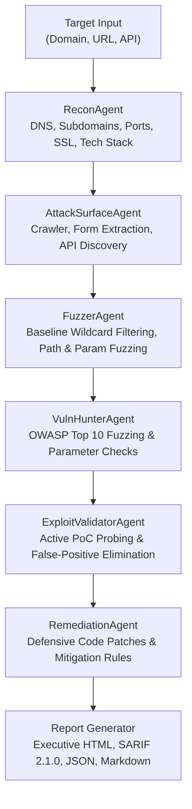

# ⚡ SWA AI — Autonomous Application Security & Penetration Testing Engine

<p align="center">
  <b>Autonomous Multi-Agent AI Red Team that discovers, validates, and fixes application vulnerabilities with zero false positives.</b>
</p>

<p align="center">
  
  
  
  
</p>

---

## 🌟 Overview

**SWA AI** (Secure Web Auditor AI) is a next-generation offensive security engineering platform. It pairs autonomous AI reasoning with dynamic verification probes to map your attack surface, enumerate subdomains, fuzz hidden assets, test for critical OWASP vulnerabilities, validate findings with verified Proof-of-Concept (PoC) exploits, and generate developer-ready code fixes.

Runs in two flexible modes:
1. **Interactive Cyber Command Center (Web UI)**: Enter your target domain or URL and monitor execution live in the background via WebSockets with real-time streaming telemetry.
2. **Headless Developer CLI**: Run in terminal or CI/CD pipelines to block vulnerabilities before reaching production.

---

## 🚀 Key Capabilities

- **Autonomous Background Execution**: Asynchronous worker pool manages non-blocking scans with live progress tracking and persistent SQLite storage.
- **Dynamic Exploit Verification**: Proves every vulnerability with verifiable proof-of-concept payloads (cURL reproduction commands) to eliminate false positives.
- **Multi-Agent Red Team Pipeline**:
  - 🔍 **ReconAgent**: Automated OSINT, passive Certificate Transparency log queries (crt.sh), active DNS dictionary subdomain resolution, high-speed asynchronous port scanner, SSL/TLS inspector, and tech stack fingerprinting.
  - ⚡ **FuzzerAgent**: High-accuracy path, directory, and hidden parameter fuzzer calibrated with baseline wildcard filters to eliminate Single Page App (SPA) false positives.
  - 🗺️ **AttackSurfaceAgent**: Web crawler, HTML form/parameter extractor, and REST/GraphQL/OpenAPI route discovery.
  - 🏹 **VulnHunterAgent**: Systematic OWASP Top 10 testing (SQL Injection, Reflected XSS, SSRF, Path Traversal/LFI, Insecure CORS, and Sensitive File Exposure).
  - 💥 **ExploitValidatorAgent**: Active verification of candidate vulnerabilities, calculating precise CVSS v3.1 scores.
  - 🛡️ **RemediationAgent**: Produces tailored defensive code patches (Python, JS/TS, PHP, Go) and web server hardening rules (Nginx, Apache).
- **Multi-Provider AI Reasoning**: Built-in support for OpenRouter, OpenAI, Anthropic, Gemini, and local Ollama models — plus a zero-dependency deterministic heuristic engine for offline operation.
- **Enterprise Reporting**: 1-click export to Executive HTML reports, SARIF 2.1.0 (GitHub Advanced Security & DefectDojo), Structured JSON, and Markdown.

---

## 🛠️ Architecture



---

## 📦 Installation & Quick Start

### 1. Clone the Repository
```bash
git clone https://github.com/545e/SWA.git
cd SWA
```

### 2. Install Dependencies
```bash
pip install -r requirements.txt
```

### 3. Launch the Web Interface
```bash
python run.py
```
Open **[http://127.0.0.1:8000](http://127.0.0.1:8000)** in your browser to enter targets and launch autonomous scans.

---

## 💻 CLI Usage

You can run automated assessments directly from your terminal:

```bash
# Run a full red team assessment
python swa_cli.py -t https://example.com --profile full_red_team

# Run a quick reconnaissance scan with HTML report export
python swa_cli.py -t https://example.com --profile quick --export-html report.html --export-sarif findings.sarif
```

### Scan Profiles

| Profile | Focus |
| :--- | :--- |
| `full_red_team` | Complete end-to-end assessment: Recon, Subdomains, Surface mapping, Fuzzing, OWASP Top 10, PoC exploit validation, and patch generation. |
| `quick` | Fast assessment of security headers, exposed sensitive files (`.env`, `.git`), and top misconfigurations. |
| `owasp_top10` | In-depth testing of Injection (SQLi, XSS), Broken Access Control, and SSRF. |
| `api_security` | Dedicated REST and GraphQL API fuzzing, parameter mining, and authorization checks. |
| `recon_only` | Passive/Active OSINT, Certificate Transparency, subdomains, open TCP ports, and technology fingerprinting. |

---

## 📁 Repository Structure

```
SWA/
├── core/
│   ├── database.py             # SQLite state store for scans, findings & logs
│   ├── llm_client.py           # Multi-provider AI reasoning & heuristic fallback
│   ├── models.py               # Pydantic schemas for targets & findings
│   └── queue_manager.py        # Async task queue & WebSocket pub/sub
├── agents/
│   ├── recon_agent.py           # Subdomain enumeration, DNS, ports & SSL
│   ├── fuzzer_agent.py          # High-accuracy directory & parameter fuzzer
│   ├── attack_surface_agent.py # Crawling, forms & API route mapping
│   ├── vuln_hunter_agent.py     # OWASP Top 10 automated security scanner
│   ├── exploit_validator_agent.py # Dynamic PoC validation & false-positive elimination
│   ├── remediation_agent.py     # Code patches & defensive mitigation rules
│   └── orchestrator.py          # Master coordinator managing assessment phases
├── reports/
│   └── generator.py            # SARIF 2.1.0, HTML, JSON & Markdown reports
├── web/
│   ├── server.py               # FastAPI backend & WebSocket event bus
│   └── static/                 # Modern Cyber Command Center Web Dashboard
│       ├── app.js              # Real-time WebSocket frontend controller
│       ├── index.html          # Responsive single-page application
│       └── styles.css          # Professional enterprise styling
├── run.py                      # 1-click web launcher
├── swa_cli.py                  # Headless CLI runner
├── requirements.txt            # Python dependencies
├── LICENSE                     # MIT License
└── README.md
```

---

## 📄 License

This project is licensed under the [MIT License](LICENSE).
