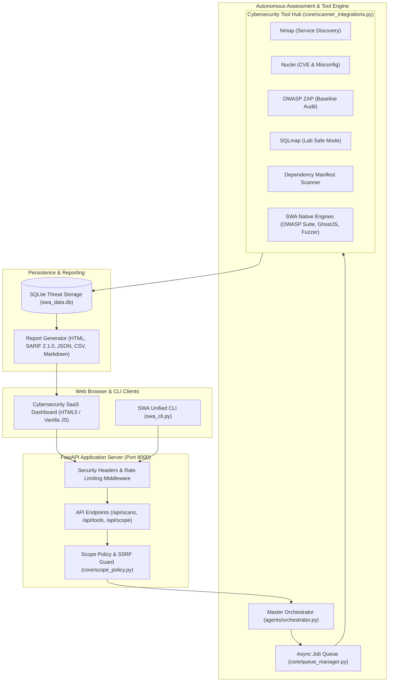

# SWA AI — System Architecture & Data Flow

## 1. System Overview

SWA AI (Secure Web Auditor AI) is an enterprise-grade autonomous and semi-automatic cybersecurity operations platform designed to deliver verified, evidence-based vulnerability intelligence with zero false positives.

---

## 2. Core Architectural Layers

### A. Presentation & Interface Layer
- **Unified Web Dashboard**: Responsive, lightweight single-page application built with modern vanilla JavaScript and CSS custom properties. Implements dark-mode first cybersecurity SaaS design, command palette (`Ctrl+K`), real-time scan telemetry, and interactive modals.
- **Unified CLI (`swa_cli.py`)**: Command-line interface with headless scanning, stdout/JSON formatting, tool readiness checks (`--check-tools`), and exit code controls (`--exit-zero`) for CI/CD pipelines.

### B. Security & Scope Enforcement Layer
- **Scope Policy (`core/scope_policy.py`)**: Validates all incoming targets (IPv4, IPv6, FQDNs).
- **SSRF Protection**: Strictly blocks loopback (`127.0.0.0/8`, `::1`), RFC 1918 private subnets (`10.0.0.0/8`, `172.16.0.0/12`, `192.168.0.0/16`), link-local IPs, and Cloud Metadata endpoints (IMDS `169.254.169.254`).
- **Lab Mode Authorization**: Local testbed services (`127.0.0.1:8000`, `localhost`, PortSwigger labs) require explicit `lab_mode=True` authorization.

### C. Multi-Agent Orchestration Engine
- **Phase 1: Scope & Target Verification**: Enforces authorized target allowlists and initializes tool inventory.
- **Phase 2: Autonomous Reconnaissance & OSINT**: Queries passive certificate transparency logs, active DNS dictionary resolution, and async TCP banner grabbing.
- **Phase 3: Attack Surface & API Discovery**: Web crawler extracts forms, endpoints, and OpenAPI/REST parameters.
- **Phase 4: Dual-Baseline Fuzzing**: Path and parameter discovery calibrated to eliminate SPA wildcard false positives.
- **Phase 5: OWASP Top 10 Hunting & Subprocess Wrappers**: Executes 10 native OWASP plugins and checks external binaries (Nmap, Nuclei, ZAP, SQLmap).
- **Phase 6: Exploit & PoC Validation**: Generates reproducible cURL reproduction commands and validates findings.
- **Phase 7: Defensive Remediation & Reporting**: Produces code patches and exports reports in SARIF 2.1.0, HTML, JSON, CSV, and Markdown.

---

## 3. Subprocess Isolation & Safety Rules

1. **Argument Arrays Only**: All subprocess execution uses `asyncio.create_subprocess_exec(*args)` with explicit argument lists. Shell interpolation (`shell=True`) with user input is strictly prohibited.
2. **Graceful Binary Degradation**: If an external binary (e.g. Nmap or Nuclei) is absent on the host PATH, SWA records its unavailability, supplies installation guidance, and falls back to native Python engines without crashing or fabricating results.
3. **Lab-Safe SQLmap Guard**: SQLmap is disabled by default. It requires explicit `lab_mode=True` authorization, strictly operates at `--level=1 --risk=1`, and omits data dumping (`--dump`) or operating system command execution (`--os-shell`).
