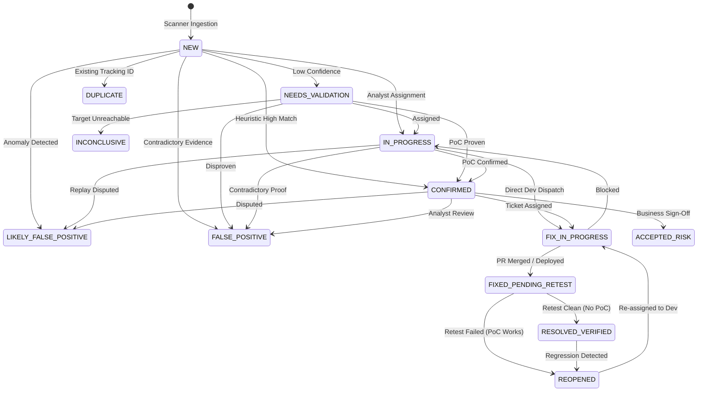

# SWA AI — Finding Lifecycle State Machine & Audit Governance

## 1. Finding Lifecycle State Machine



---

## 2. Permitted Transitions Matrix (§5.2)

```python
PERMITTED_LIFECYCLE_TRANSITIONS = {
    "NEW": {"NEEDS_VALIDATION", "IN_PROGRESS", "CONFIRMED", "LIKELY_FALSE_POSITIVE", "FALSE_POSITIVE", "DUPLICATE"},
    "NEEDS_VALIDATION": {"IN_PROGRESS", "CONFIRMED", "LIKELY_FALSE_POSITIVE", "FALSE_POSITIVE", "DUPLICATE", "INCONCLUSIVE", "ACCEPTED_RISK"},
    "IN_PROGRESS": {"CONFIRMED", "LIKELY_FALSE_POSITIVE", "FALSE_POSITIVE", "INCONCLUSIVE", "FIX_IN_PROGRESS", "ACCEPTED_RISK"},
    "CONFIRMED": {"FIX_IN_PROGRESS", "ACCEPTED_RISK", "DUPLICATE", "LIKELY_FALSE_POSITIVE", "FALSE_POSITIVE", "NEEDS_VALIDATION"},
    "LIKELY_FALSE_POSITIVE": {"FALSE_POSITIVE", "CONFIRMED", "NEEDS_VALIDATION", "IN_PROGRESS"},
    "FALSE_POSITIVE": {"REOPENED", "NEEDS_VALIDATION"},
    "DUPLICATE": {"REOPENED", "NEEDS_VALIDATION"},
    "ACCEPTED_RISK": {"REOPENED", "FIX_IN_PROGRESS", "NEEDS_VALIDATION"},
    "FIX_IN_PROGRESS": {"FIXED_PENDING_RETEST", "IN_PROGRESS", "ACCEPTED_RISK"},
    "FIXED_PENDING_RETEST": {"RESOLVED_VERIFIED", "REOPENED", "FIX_IN_PROGRESS", "INCONCLUSIVE"},
    "RESOLVED_VERIFIED": {"REOPENED"},
    "REOPENED": {"IN_PROGRESS", "NEEDS_VALIDATION", "CONFIRMED", "FIX_IN_PROGRESS"},
    "INCONCLUSIVE": {"NEEDS_VALIDATION", "IN_PROGRESS", "LIKELY_FALSE_POSITIVE", "FALSE_POSITIVE", "CONFIRMED"}
}
```

---

## 3. Strict Non-Permitted Transitions

To maintain SOC integrity and compliance, the following shortcuts are strictly forbidden by database enforcement:
- `CONFIRMED` &rarr; `RESOLVED_VERIFIED` (Direct closure without retest is rejected).
- `NEW` &rarr; `RESOLVED_VERIFIED` (Cannot close without passing through engineering fix and retest verification).
- `FALSE_POSITIVE` &rarr; `RESOLVED_VERIFIED` (False positives must be reopened and triaged if re-evaluated).
