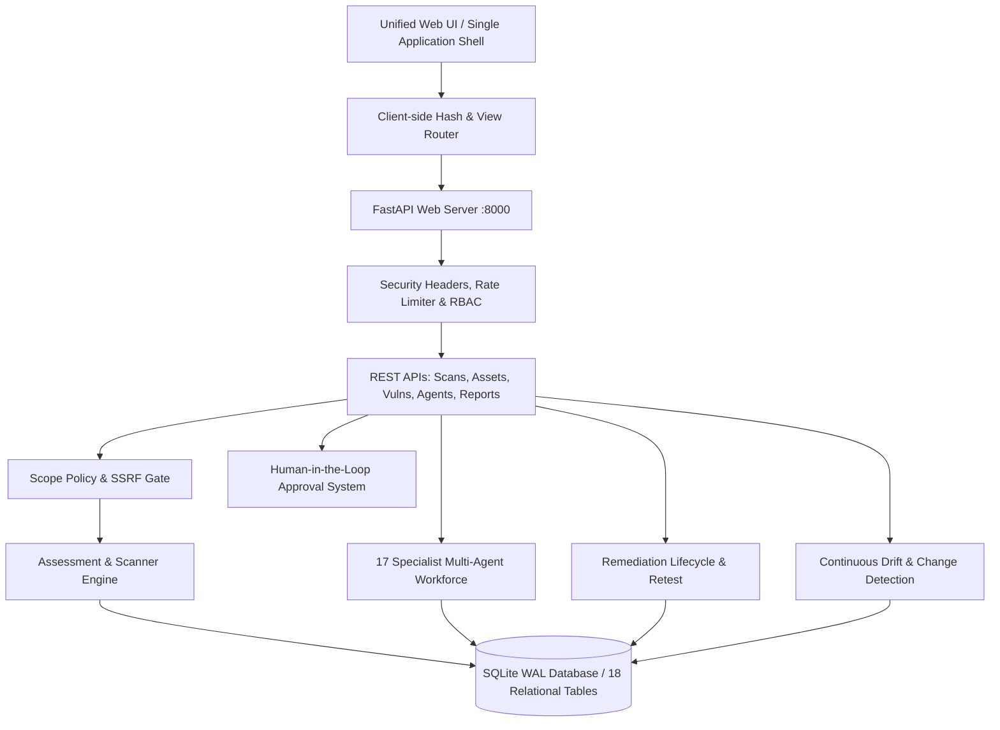

# SWA AI — Generation 3 Architecture Specification

## 1. System Overview & Architectural Principles

SWA AI is an enterprise-grade autonomous cybersecurity operations platform built as a modular, high-performance monolith with clean service boundaries. It eliminates the complexity and latency of distributed microservices while providing isolated, testable modules for:
- Attack Surface Discovery & Asset Intelligence
- Native Multi-Vector Vulnerability Assessment
- Specialist Multi-Agent Orchestration & Investigation
- Continuous EASM Drift Detection & Approval Governance
- Defensible Risk Modeling & Remediation Lifecycle Tracking
- Executive & Technical Multi-Format Reporting

---

## 2. Layered Architecture

### 2.1 Presentation Layer (Frontend)
- **Single Application Shell:** Responsive layout composed of a fixed/collapsible left sidebar, compact top navigation bar, and main viewport.
- **Client-Side Hash Router:** Synchronizes URL hashes (e.g., `#/dashboard`, `#/vulnerabilities`, `#/assessments`, `#/security-tools`) with browser history, active sidebar items, breadcrumbs, and isolated `
` view containers.
- **Unified Design System:** Professional dark navy background (`#0b0f19`), charcoal card surfaces (`#111827`), subtle borders (`#1f2937`), and WCAG-compliant high-contrast typography.

### 2.2 Application & API Layer (Backend)
- **Framework:** FastAPI running on Uvicorn ASGI server.
- **Middleware Pipeline:**
  1. Production Security Headers (`nosniff`, `SAMEORIGIN`, CSP, Referrer-Policy).
  2. Token-Bucket Rate Limiter with burst capacity and local loopback exemption for scanner operations.
  3. RBAC & Session Management supporting auditor, admin, and viewer roles.
- **Input Validation:** Pydantic v2 schemas for all request payloads.

### 2.3 Core Assessment & Security Layer
- **Scope Policy Engine:** Strict SSRF gate inspecting target URIs, preventing access to loopback, RFC1918 subnets, link-local addresses, and cloud instance metadata (`169.254.169.254`) unless explicit lab authorization is configured.
- **Integrated Tool Adapter Suite:** Native Python crawlers, passive DNS/subdomain engines, HTTP header inspectors, and standard security tool adapters (Nmap, Nuclei, OWASP ZAP, Subfinder) with availability detection and execution timeouts.

### 2.4 Autonomous Intelligence Layer
- **17 Specialist Agents:** Defined contracts, inputs, outputs, and scope limits across Recon, Asset Intelligence, Web Security, Network Security, API Security, Code Security, Vulnerability Analysis, Threat Intelligence, Risk Assessment, Remediation, and QA Verification.
- **Prompt Injection Defense:** Strict XML boundary wrapping (`<untrusted_target_evidence_boundary>`) ensuring raw evidence is processed strictly as inert data.

### 2.5 Persistence Layer
- **Engine:** SQLite 3 with Write-Ahead Logging (`PRAGMA journal_mode = WAL;`) and Foreign Key enforcement (`PRAGMA foreign_keys = ON;`).
- **Data Model:** 18 relational tables with 15 optimized B-Tree indexes for sub-millisecond query performance on findings, scans, assets, and audit logs.
- **Backup:** Zero-downtime online backup API via SQLite Online Backup API.
