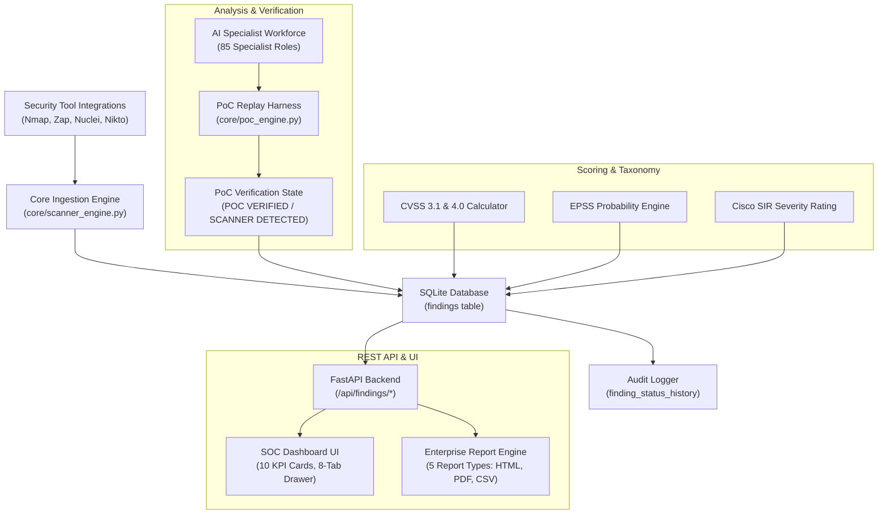

# SWA AI — Vulnerability Management System Architecture

## 1. Executive Summary & Overview

SWA AI provides an autonomous, enterprise-grade Vulnerability Management & Findings operations platform. It unifies automated scanner discovery, multi-agent AI verification, CVSS 3.1 & 4.0 / EPSS risk scoring, evidence-backed proof-of-concept (PoC) validation, formal audit trails, and end-to-end remediation lifecycle governance.

Unlike legacy security dashboards that display static scanner outputs, SWA AI enforces an **evidence-first verification policy**: findings are classified with rigorous lifecycle and remediation status codes, and the prestigious `PoC VERIFIED` badge is awarded strictly when actionable reproduction evidence has been autonomously replayed and confirmed against target infrastructure.

---

## 2. System Architecture & Component Interactions

---

## 3. Data Model Schema

The `findings` table provides additive, schema-preserving columns:

| Column | Type | Description |
|---|---|---|
| `id` | `VARCHAR(64) PRIMARY KEY` | Deterministic unique finding identifier (e.g. `FIND-TEST-0001`) |
| `scan_id` | `VARCHAR(64)` | Associated assessment job ID |
| `title` | `VARCHAR(255)` | Vulnerability finding title |
| `severity` | `VARCHAR(32)` | CVSS qualitative severity (`CRITICAL`, `HIGH`, `MEDIUM`, `LOW`, `NONE`, `UNCLASSIFIED`) |
| `cvss_score` | `REAL` | CVSS numeric base score (0.0 – 10.0) |
| `cvss_vector` | `VARCHAR(128)` | Full CVSS 3.1/4.0 vector string |
| `epss_score` | `REAL` | Exploit Prediction Scoring System probability (0.0 – 1.0) |
| `cisco_sir` | `VARCHAR(32)` | Cisco Security Impact Rating (`Critical`, `High`, `Moderate`, `Low`) |
| `lifecycle_status` | `VARCHAR(32)` | 13-state finding lifecycle status (`CONFIRMED`, `NEW`, `IN_PROGRESS`, etc.) |
| `remediation_status` | `VARCHAR(32)` | 8-state remediation tracking status (`OPEN`, `ASSIGNED`, `RESOLVED`, etc.) |
| `poc_verification_state`| `VARCHAR(32)` | Verification state (`POC VERIFIED`, `SCANNER DETECTED`, `NEEDS VERIFICATION`) |
| `poc_curl` | `TEXT` | Reproducible shell cURL execution command |
| `request_evidence` | `TEXT` | Raw HTTP request headers and payload |
| `response_evidence`| `TEXT` | Raw HTTP response headers and body confirming vulnerability |
| `remediation_advice`| `TEXT` | Actionable mitigation instructions |
| `remediation_patch` | `TEXT` | Code diff or patch snippet |
| `reviewer` | `VARCHAR(128)` | Senior analyst who conducted false-positive or lifecycle review |
| `false_positive_reason`| `TEXT` | Documented contradictory evidence and justification for suppression |
| `created_at` | `DATETIME` | Initial discovery timestamp (ISO 8601 UTC) |
| `last_status_change`| `DATETIME` | Most recent state transition timestamp |

---

## 4. REST API Endpoint Catalog

1. `GET /api/findings/metrics`: Returns 10-card summary metrics, severity distribution percentages, and lifecycle distribution.
2. `GET /api/findings`: Multi-dimensional search, severity filtering, pagination (`limit`, `offset`), sorting, and backward-compatible list output.
3. `GET /api/findings/{id}`: Detailed finding payload including attached chronological audit history.
4. `POST /api/findings/{id}/transition`: Validated lifecycle or remediation state transition.
5. `POST /api/findings/{id}/false-positive`: Dedicated false-positive review submission with analyst sign-off.
6. `GET /api/findings/{id}/history`: Chronological audit trail for the finding.
7. `GET /api/findings/export`: Filtered dataset export in CSV, JSON, HTML, PDF, or Markdown.
8. `GET /api/reports/vulnerability/{report_type}`: Generates Executive (§10.1), Technical (§10.2), Individual (§10.3), False-Positive (§10.4), or Remediation (§10.5) security reports.
