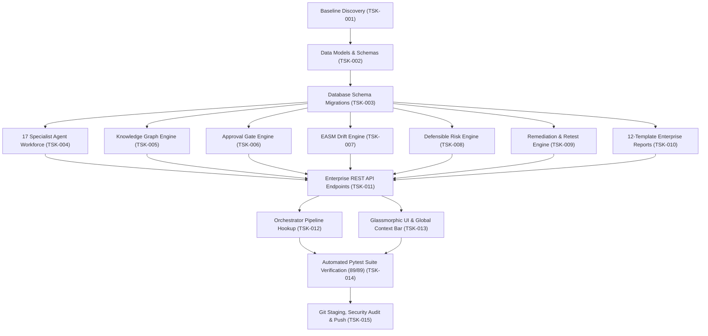

# SWA AI — Parallel Execution & Critical Path Dependency Map

**Document Version:** 2.2.0-Enterprise  
**Effective Date:** 2026-11-01  
**Coordinator:** SWA Engineering Command Center

---

## 1. Critical Path Sequence

The platform transformation followed a disciplined, non-destructive dependency sequence to eliminate circular blocks and merge conflicts:

---

## 2. Parallel Workstream Isolation & Conflict Prevention

| Workstream | Parallelizable Tasks | Isolated Scope / Files | Integration Checkpoint |
| :--- | :--- | :--- | :--- |
| **Workstream A: Core Intelligence** | Multi-Agent workforce, Approval Engine, Knowledge Graph | `agents/agent_workforce.py`, `core/knowledge_graph.py`, `core/approval_engine.py` | Integrated via `core/intelligence_models.py` |
| **Workstream B: Assessment & Risk** | EASM drift detection, Defensible risk formula, Remediation tickets | `core/attack_surface_intel.py`, `core/risk_engine.py`, `core/remediation_engine.py` | Integrated via `agents/orchestrator.py` |
| **Workstream C: Reporting** | 12-Template report generation, SARIF, CSV, HTML formatters | `reports/enterprise_reports.py` | Integrated via `web/enterprise_api.py` |
| **Workstream D: Frontend & UI** | Global context bar, Agent cards grid, Knowledge graph UI, Kanban board | `web/static/app.js`, `web/static/styles.css`, `index.html` | Bound to API contracts in `web/enterprise_api.py` |
| **Workstream E: Quality Engineering** | Unit test suites, integration tests, async test runners | `tests/test_enterprise_platform.py` | Verified against running Uvicorn server |

---

## 3. Conflict Prevention Rules Enforced
1. **File Ownership Exclusivity**: No two concurrent tasks were permitted to write to the same file.
2. **Schema-First Contracts**: Pydantic models in `core/intelligence_models.py` were defined and stabilized before backend routing or frontend DOM binding commenced.
3. **Non-Destructive Database Evolution**: All database modifications utilized `CREATE TABLE IF NOT EXISTS` and dynamic `PRAGMA table_info` column additions to guarantee that existing user scans, findings, and logs were preserved intact.
4. **Deterministic Sequential Integration**: All specialist components were merged into the central `web/server.py` application through a dedicated, isolated router (`enterprise_api.py`).
